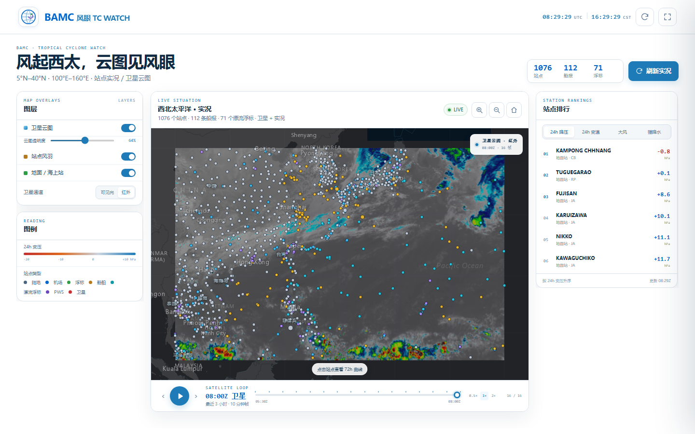
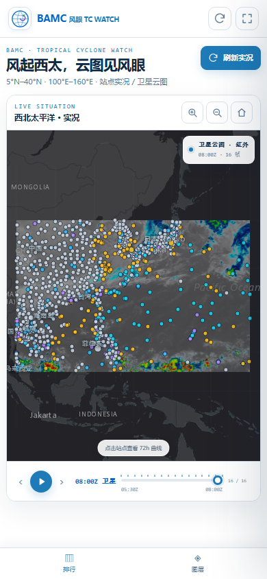

# BAMC 风眼 · TC WATCH

西北太平洋热带气旋实况监测平台，范围 **5°N–40°N，100°E–160°E**。浅色业务界面 + 深色地图视窗，站点、船舶、漂流浮标与卫星云图在同一屏内查看。





---

## 当前已实现

- **地面/机场站**：METAR + SYNOP 双源接入，按 ICAO/WMO/名称去重，统一 m/s、hPa、°C、mm。
- **Windy 补充站**：WMO/PWS/MADIS/船舶/浮标，按 5° 网格查询并去重；当前补充约 100 条船报和 100 个 PWS。
- **GDP 漂流浮标**：NOAA Global Drifter Program 活动浮标，提供 SST、SLP，部分有气温/波高/风向。
- **24h 指标**：站点 24h 变压、24h 变温、3h/24h 降水、阵风、相对湿度；缺测显示 `—`，不做模式补值。
- **站点排行**：24h 降压、24h 变温、大风、强降水四个榜，点击定位并打开详情。
- **站点详情**：72h 气压/气温/湿度/风速/阵风/降水曲线。
- **卫星**：可见光/红外，3 小时 10 分钟帧动画，支持播放/暂停/0.5×/1×/2×、透明度。
- **自动重试**：所有源失败重试、保留上次成功数据；后台调度每 5–10 分钟更新。
- **移动端**：地图全屏、底部抽屉、两个面板入口、站点详情全屏。

### 当前数据快照（2026-11-18 08:2x UTC）

- 站点：约 **1076 个**；Ogimet SYNOP 覆盖约 **630 站**。
- 有 24h 变压：约 **627 站**。
- 卫星：3 小时窗口（可见光 + 红外），页面显示每帧 UTC 时间。
- 船舶：约 **100 条**（Windy）；漂流浮标：约 **70 个**（GDP）。

> VPN 开启后的逐项连通性复查见 [docs/DATA_STATUS.md](docs/DATA_STATUS.md)。

---

## 快速开始

要求 Python 3.11+。本项目已经在 Python 3.14 上跑通。

```powershell
cd tc-watch
python -m pip install -r backend/requirements.txt
cd backend
python -m uvicorn app.main:app --host 127.0.0.1 --port 8787
```

打开 **http://127.0.0.1:8787**。

也可以双击 `start.bat`。

### 数据目录

首次启动会自动创建：

```text
data/
├─ tcwatch.db          # SQLite
├─ frames/             # 卫星 PNG 帧
├─ cache/              # SAMOS netCDF、WMO 元数据等
└─ logs/
```

站点坐标元数据来自 `isd-history.csv`，放在项目根目录；首次启动会生成 `data/wmo_stations.json` 缓存。

### 常用环境变量

| 变量 | 默认 | 说明 |
|---|---|---|
| `TCW_PORT` | `8787` | 本机端口 |
| `TCW_SYNOP_BLOCKS` | `45,46,47,48,52,53,54,56,57,58,59,91,96,98,99` | 要抓的 WMO block |
| `TCW_SATELLITE_HOURS` | `3` | 卫星动画窗口 |
| `TCW_SATELLITE_ZOOM` | `5` | GIBS 拼接 zoom |
| `TCW_METAR_INTERVAL` | `300` | METAR 更新秒数 |
| `TCW_SYNOP_INTERVAL` | `600` | SYNOP 更新秒数 |
| `TCW_TC_INTERVAL` | `300` | 台风更新秒数 |

---

## 数据源

| 数据 | 来源 | 用途 | 当前状态 |
|---|---|---|---|
| 机场站 METAR | [Aviation Weather Center](https://aviationweather.gov/api/data/metar?bbox=5,100,40,160&format=json&hours=3) | 风、温度、湿度、QNH | ✅ 正常 |
| 地面 SYNOP | [Ogimet](https://www.ogimet.com/cgi-bin/getsynop) | MSLP、3h 气压倾向、降水、气温、风 | ✅ 正常，655 站 |
| 浮标 | [NDBC](https://www.ndbc.noaa.gov/) | 海面风、气压、气温、水温 | ✅ 正常 |
| Windy 补充站 | [Windy](https://www.windy.com/) | WMO/PWS/MADIS/船舶/浮标 | ✅ 正常，约 100 条船报 |
| GDP 漂流浮标 | [NOAA GDP / UCSD](https://out-gdpsio.ucsd.edu/apps/projects/noaa/global-drifter-program.html) | SST、SLP、部分气温/波高/风向 | ✅ 正常，约 70 个 |
| 船舶/平台 | [SAMOS / COAPS](https://samos.coaps.fsu.edu/html/webservices.php) | 科考船/商船近实时观测 | ✅ 接口正常，当前域内 0 条 |
| 卫星云图 | [NASA GIBS / Himawari-9](https://gibs.earthdata.nasa.gov/wmts/epsg3857/best/1.0.0/WMTSCapabilities.xml) | B03 可见光、B13 红外 | ✅ 正常 |

### 数据边界（重要）

- **不做气压/风场模式背景**：这是按需求明确去掉的，地图上的气压/风只来自站点观测和台风官方风圈。
- **海洋站点稀疏**：5–40N/100–160E 大部分是洋面，固定站主要在陆地/岛屿/机场；没有伪造“海上站点”。
- **船舶数据**：Windy 补充站当前提供约 100 条船报；SAMOS 仍作为备用，当前域内 0 条。
- **漂流浮标**：GDP 运行数据提供约 70 个活动浮标，主要是 SST/SLP，部分有气温/波高/风向；没有风速时不伪造。
- **Windy 接口**：使用 Windy 地图的 POI 接口做小范围补充，不是 Windy 官方开放数据 API；使用需遵守 Windy 条款。接口变动时会自动降级，不影响 METAR/SYNOP/NDBC。
- **卫星反演点**：ASCAT/IMERG 的**数值**产品需要 NASA Earthdata / EUMETSAT 账号；当前接入的是 GIBS 卫星云图和 IMERG 降水瓦片，没有伪造卫星点观测。
- **卫星延迟**：GIBS 的 Himawari-9 帧通常延迟约 30–60 分钟；页面会显示每帧 UTC 时间，不假装“实时”。
- **QNH 与 MSLP**：METAR 的 `altim` 是 QNH，SYNOP 的 `4PPPP` 是 MSLP；站点详情会标出气压口径。
- **24h 变化**：要求同一来源、两端观测在目标时刻 ±45 分钟内；不满足就显示 `—`。

---

## 架构

```text
CMA / JMA / METAR / SYNOP / NDBC / Windy / GDP / SAMOS / GIBS
                    │
                    ▼
        FastAPI ingest + APScheduler 线程
                    │
                    ▼
        SQLite WAL（stations, observations, station_current,
                   storms, track_points, satellite_frames）
                    │
                    ▼
        FastAPI REST  ──  /api/overview /stations /rankings /satellite /status
                    │
                    ▼
        Leaflet + ECharts + 原生 JS（无前端构建步骤）
```

- 后端：Python、FastAPI、SQLite WAL、requests、Pillow、netCDF4。
- 前端：Leaflet 1.9、ECharts 5，本地静态资源，无 npm build。
- 卫星：GIBS WMTS 瓦片 -> Pillow 按 100–160E/5–40N 拼接 -> PNG 帧。
- 底图：Esri Dark Gray Canvas；断网时仍显示本地 Natural Earth 海岸线。

### API

```text
GET  /api/overview
GET  /api/stations?limit=2200
GET  /api/stations/{id}?hours=72
GET  /api/rankings?metric=dp24|dt24|wind|rain
GET  /api/satellite/frames?channel=ir|visible&hours=3
POST /api/refresh
GET  /api/health
```

---

## 验证记录

- `node --check web/app.js` 通过。
- 桌面 1440×900、移动端 390×844（Chrome CDP）截图通过。
- 站点详情 4 张 ECharts 图正常渲染。
- 移动端排行/图层抽屉可用。
- 站点与卫星接口正常；Windy 约 100 条船报。

---

## 免责声明

本项目为科研/教学/信息展示用途，**不是官方预警产品**。站点观测可能存在延迟、缺测或错误；卫星云图为派生可视化，不代表官方定强。
